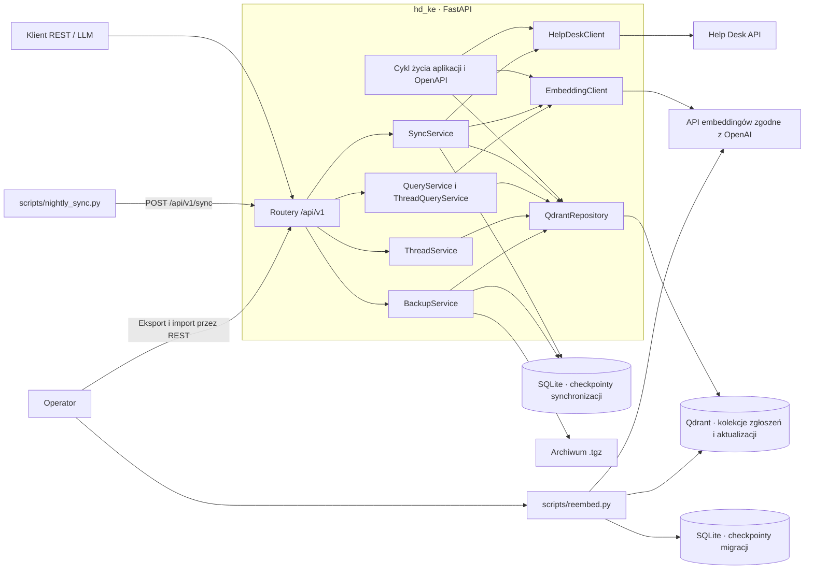
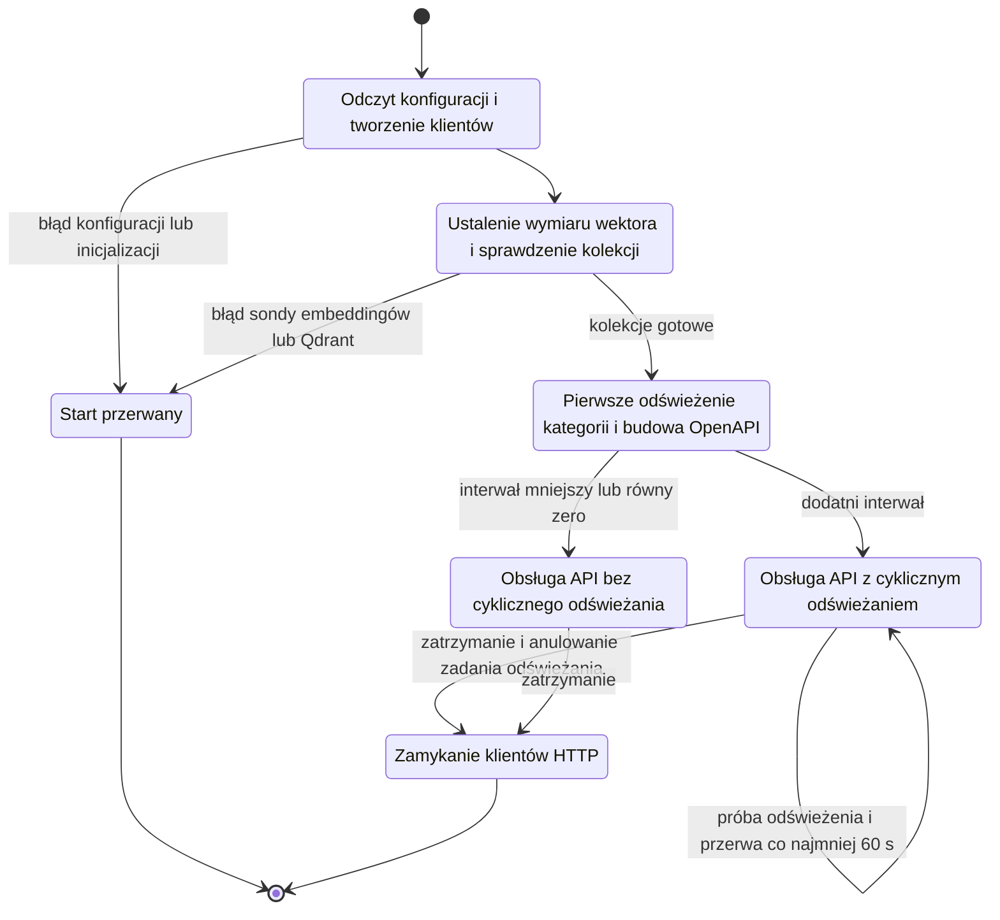

# Architektura hd_ke

## Komponenty i zależności

Źródła w repozytorium — [montowanie routerów i tworzenie klientów](../app/main.py), [zależności FastAPI](../app/api/deps.py), [serwisy](../app/services/), [skrypt synchronizacji](../scripts/nightly_sync.py), [skrypt migracji](../scripts/reembed.py), [kontener](../Dockerfile) i [jednostka systemd](../deploy/hd_ke.service).

## Cykl życia aplikacji

Przy starcie aplikacja używa wymiaru z `EMBEDDING_DIM` albo odczytuje go z próbnego wywołania `/embeddings`. Qdrant tworzy brakujące kolekcje i sprawdza wymiar istniejących. Gdy Help Desk zwróci błąd, przekroczy limit czasu lub zwróci pustą listę kategorii, aplikacja zachowuje dotychczasowy słownik. Przed pierwszą udaną próbą korzysta z kategorii domyślnych. Limit czasu klienta Help Desk i klienta embeddingów wynosi 30 s na wywołanie.

Źródła w repozytorium — [cykl życia i pamięć podręczna OpenAPI](../app/main.py), [konfiguracja](../app/core/config.py), [klient Help Desk](../app/clients/helpdesk.py), [klient embeddingów](../app/clients/embeddings.py) i [inicjalizacja kolekcji](../app/clients/qdrant.py).
