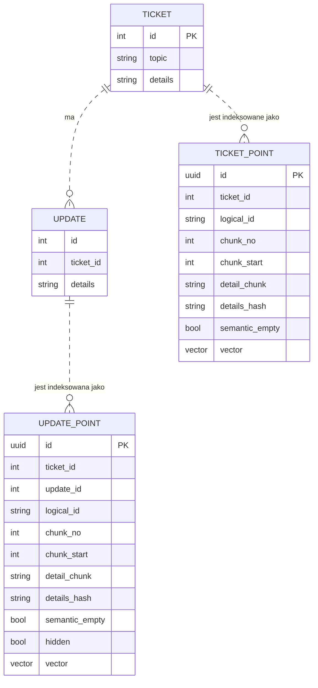
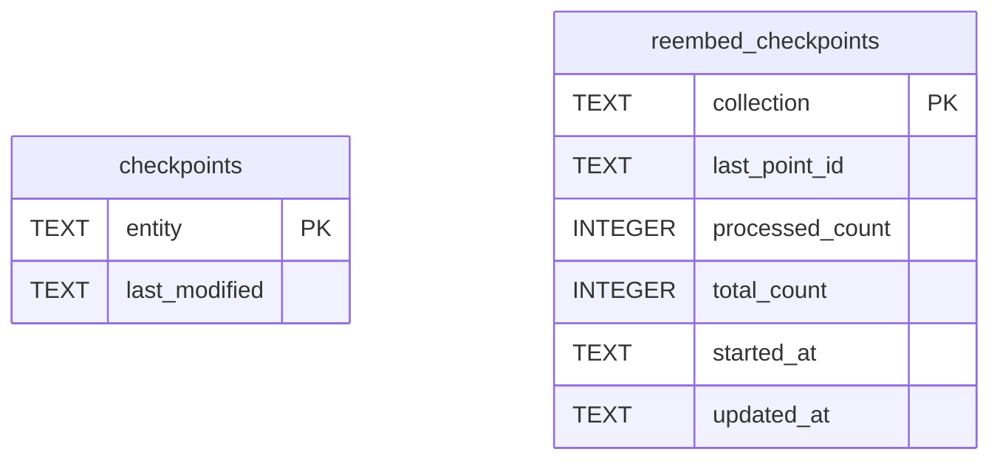

# Model danych

## Zgłoszenia, aktualizacje i punkty Qdrant

`TICKET` i `UPDATE` to rekordy z Help Desk. `TICKET_POINT` i `UPDATE_POINT` to punkty w domyślnych kolekcjach `hd_ticket_chunks` i `hd_update_chunks`. Diagram pokazuje wybrane pola. Relacje są logiczne i aplikacja odczytuje je po `ticket_id` oraz `update_id`.

Każdy punkt ma wektor i payload. UUID punktu powstaje deterministycznie z `logical_id` w formacie `ticket-{ticket_id}-{chunk_no}` lub `update-{ticket_id}-{update_id}-{chunk_no}`. `details_hash` zawiera SHA-256 oryginalnej treści wpisu. Odczyt łączy fragmenty według ich pozycji w tekście.

Źródła w repozytorium — [modele rekordów](../app/models/schemas.py), [budowa punktów i payloadów](../app/services/sync.py), [podział tekstu](../app/utils/chunking.py), [rekonstrukcja](../app/services/thread.py) i [konfiguracja kolekcji](../app/clients/qdrant.py).

## Checkpointy w SQLite

Tabela `checkpoints` w `state.db` przechowuje znaczniki synchronizacji osobno dla `tickets` i `updates`. Tabela `reembed_checkpoints` w `reembed_state.db` przechowuje postęp według nazwy kolekcji źródłowej. Oba pliki domyślnie znajdują się w `/var/lib/hd_ke`.

Źródła w repozytorium — [tabela synchronizacji](../app/services/sync.py), [konfiguracja ścieżki synchronizacji](../app/core/config.py) i [tabela migracji oraz ścieżka domyślna](../scripts/reembed.py).
