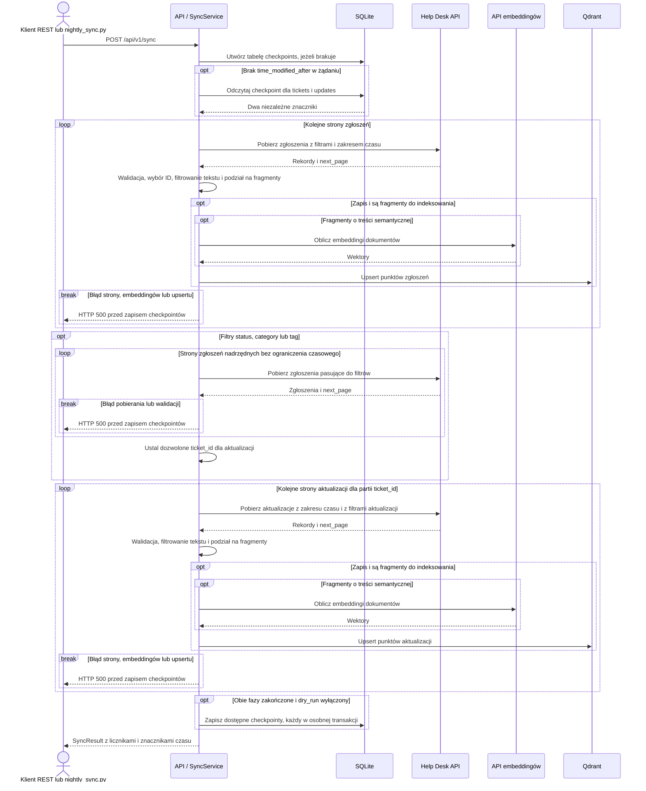

# Synchronizacja z Help Desk

## Przebieg `POST /api/v1/sync`

- `time_modified_after` podany w żądaniu zastępuje oba odczyty checkpointów. Bez filtrów zgłoszenia nadrzędnego aktualizacje mogą być ograniczone do `ticket_id` z żądania. Jawnie ustalone ID są dzielone na partie po najwyżej 200, a pusta lista dopasowań pomija pobieranie aktualizacji.
- Rekordy dopasowane do `THREAD_FILTER_PATTERNS` są pomijane. Fragmenty treści uznanej za semantycznie pustą trafiają do Qdrant z wektorem zerowym. Przy `dry_run` aplikacja nadal inicjalizuje tabelę i liczy przetworzone rekordy, a wywołania embeddingów, upsert i zapisy checkpointów są pomijane.
- Przekroczenie limitu czasu Help Desk lub embeddingów (30 s) kończy żądanie błędem. Dla `ResponseHandlingException` podczas upsertu repozytorium wykonuje do trzech prób z przerwami 1 s i 2 s. Błąd podczas przetwarzania stron kończy synchronizację przed zapisem checkpointów, a wcześniejsze upserty mogą pozostać w Qdrant. Kolejne uruchomienie może przetworzyć je ponownie, używając tych samych identyfikatorów punktów.
- `nightly_sync.py` domyślnie ustawia limit czasu klienta HTTP na 120 s i kończy z kodem `1` po błędzie HTTP, przekroczeniu limitu albo nieprawidłowej odpowiedzi. Limit po stronie klienta dotyczy oczekiwania na odpowiedź. Zapis punktów i checkpointów odbywa się w aplikacji.

Źródła w repozytorium — [endpoint](../app/api/v1/routes_sync.py), [algorytm synchronizacji i SQLite](../app/services/sync.py), [walidacja danych](../app/models/schemas.py), [klient Help Desk](../app/clients/helpdesk.py), [klient embeddingów](../app/clients/embeddings.py), [ponowienia upsertu](../app/clients/qdrant.py) i [klient nocny](../scripts/nightly_sync.py).
