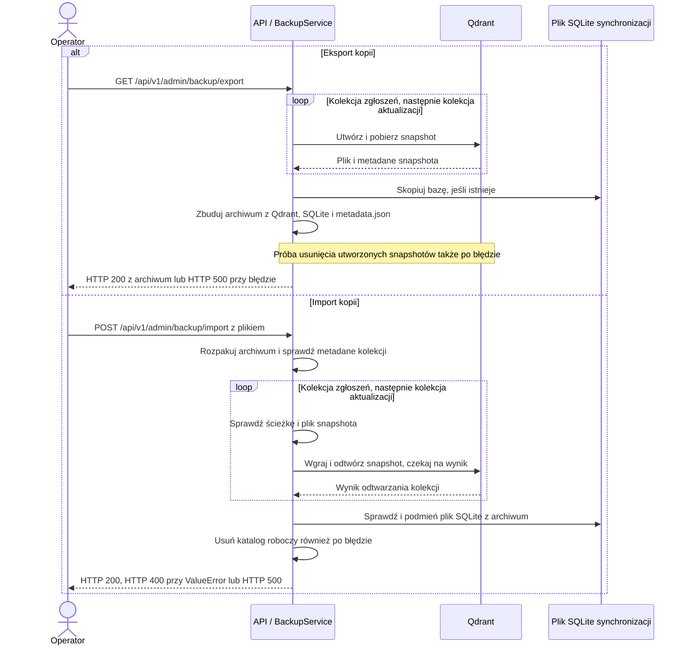
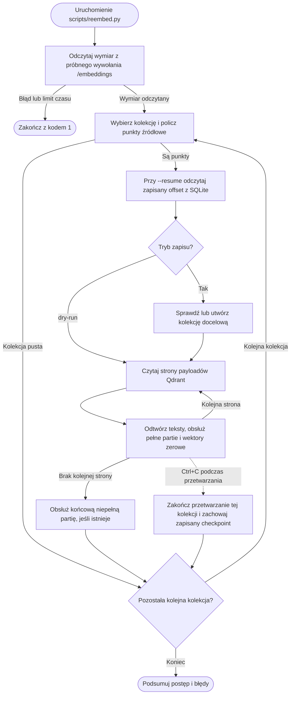

# Kopie zapasowe i migracja wektorów

## Eksport i import kopii zapasowej

Gdy plik SQLite jeszcze nie istnieje, eksport tworzy w archiwum pusty plik. Po pomyślnym wysłaniu archiwum API usuwa katalog roboczy eksportu w zadaniu w tle. Import przerywa się przy pierwszym błędzie. Jeśli odtwarzanie kolejnej kolekcji lub podmiana SQLite się nie powiedzie, wcześniej odtworzona kolekcja pozostaje w Qdrant.

Źródła w repozytorium — [endpointy i odpowiedzi HTTP](../app/api/v1/routes_backup.py), [obsługa archiwum, snapshotów i SQLite](../app/services/backup.py).

## Migracja na nowy model embeddingów

- W trybie `--dry-run` skrypt odczytuje payloady i liczy rekordy. W trybie zapisu robi upsert partii z nowymi embeddingami, a punkty z wektorem zerowym zapisuje po przetworzeniu każdej strony.
- Klient embeddingów ma limit czasu 120 s. Wykonuje maksymalnie trzy próby embeddingu partii przy HTTP 429 lub błędzie transportu, w tym przy przekroczeniu limitu czasu. Upsert partii z embeddingami również ma maksymalnie trzy próby. Po błędzie takiej partii skrypt zlicza błędne punkty i kontynuuje. Błędy w podsumowaniu dają kod wyjścia `1`.
- Checkpoint jest zapisywany po udanym upsercie pełnej partii z embeddingami. `--resume` używa ostatniego zapisanego identyfikatora punktu jako offsetu. Zapis checkpointu po późniejszej udanej partii może przesunąć offset poza wcześniejszą partię zakończoną błędem.
- Błąd odczytu strony z Qdrant, zapisu punktów z wektorem zerowym lub zapisu checkpointu przerywa skrypt.

Po migracji przełączenie serwisu na kolekcje docelowe wymaga zmiany `QDRANT_TICKET_COLLECTION` i `QDRANT_UPDATE_COLLECTION` oraz restartu usługi.

Źródła w repozytorium — [skrypt migracji i wznowienie](../scripts/reembed.py), [ustawienia aplikacji](../app/core/config.py) i [opis przełączenia kolekcji](../README.md#migracja-modelu-embeddingowego-re-embed).
