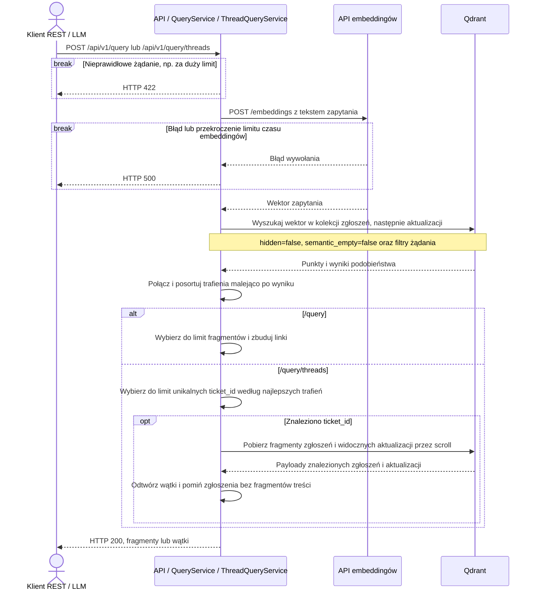
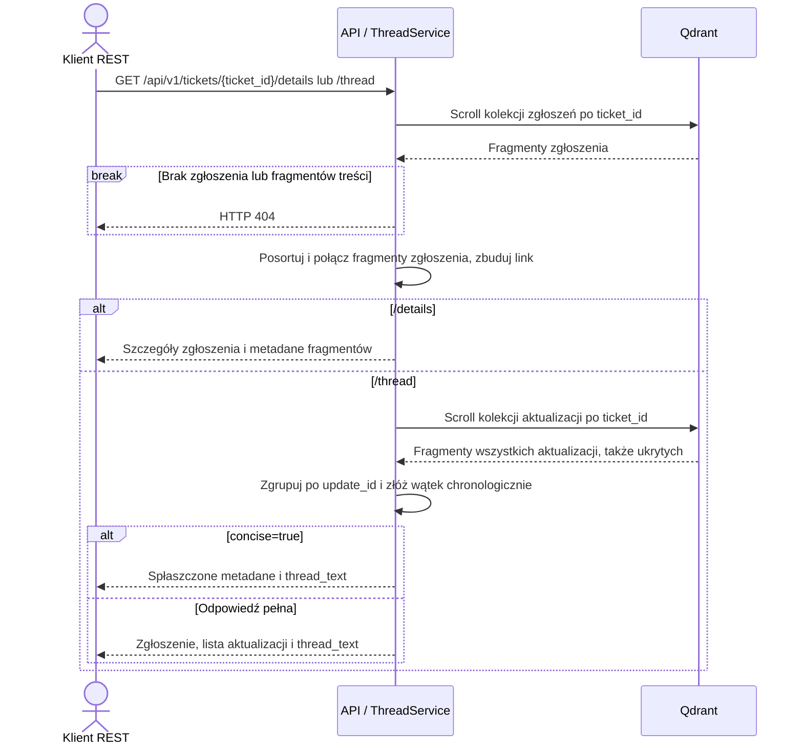

# Wyszukiwanie i odtwarzanie wątków

## Wyszukiwanie semantyczne

Wyszukiwanie wątków pobiera do `min(3 × limit, 100)` kandydatów z każdej kolekcji. Przy odtwarzaniu wybranych wątków widoczne aktualizacje mogą zawierać fragmenty z `semantic_empty=true`. Brak trafień daje pustą listę, a błędy zapytań do Qdrant dają HTTP 500. `debug=true` zachowuje pola techniczne przewidziane przez model odpowiedzi danego endpointu.

Źródła w repozytorium — [endpointy i formatowanie odpowiedzi](../app/api/v1/routes_query.py), [walidacja limitu i filtry wejściowe](../app/models/schemas.py), [wyszukiwanie fragmentów](../app/services/query.py), [wyszukiwanie wątków](../app/services/thread_query.py), [klient embeddingów](../app/clients/embeddings.py) i [repozytorium Qdrant](../app/clients/qdrant.py).

## Odczyt zgłoszenia po identyfikatorze

Treść jest składana z `detail_chunk` w kolejności `chunk_start`, a następnie `chunk_no`. Kody odpowiedzi dla poprawnych ścieżek w diagramie to HTTP 200. Błędy połączenia z Qdrant dają HTTP 500.

Źródła w repozytorium — [endpointy odczytu i mapowanie błędów](../app/api/v1/routes_query.py), [rekonstrukcja tekstu](../app/services/thread.py) i [paginacja odczytu Qdrant](../app/clients/qdrant.py).
